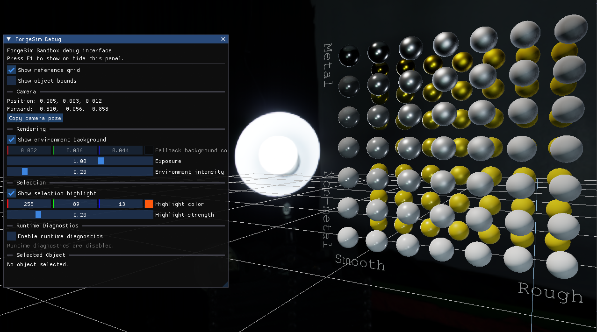
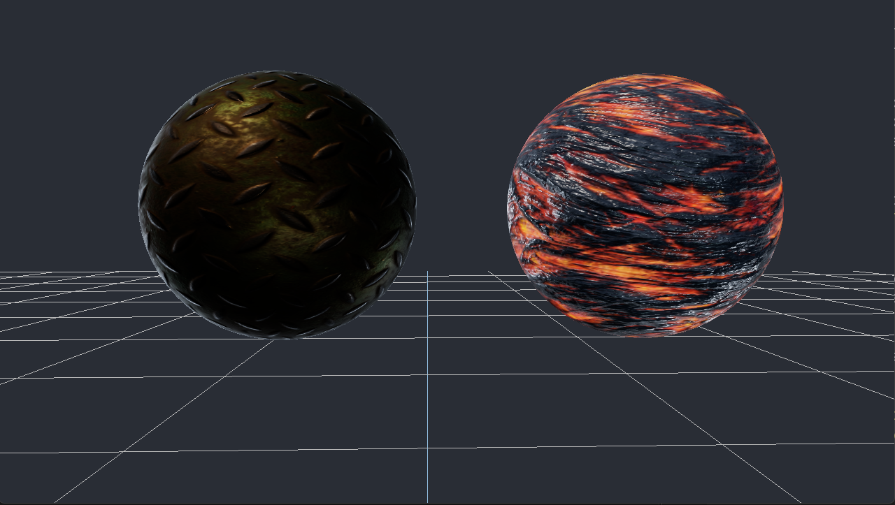

# ForgeSim

ForgeSim is an independently developed real-time simulation engine and editor written in modern C++, focused on interactive mechanical systems.

The project is being developed as a foundation for simulation-heavy games, interactive simulations, and training applications where mechanical components, equipment, tools, and other simulated systems can be represented through reusable engine and simulation infrastructure.

ForgeSim is currently in early development. The architecture and feature set will continue to evolve as concrete simulation requirements emerge.

## Vision

ForgeSim is intended to explore an engine architecture in which simulation systems are first-class components rather than application-specific implementations.

Potential applications include:

- Mechanical systems and assemblies
- Vehicle and equipment simulation
- Component interaction, replacement, and failure
- Interactive tools and maintenance workflows
- Procedural training scenarios
- Simulation-heavy games
- Debugging and visualization of simulated systems
- Future immersive and VR interaction

The long-term goal is not to reproduce the feature set of a general-purpose commercial game engine, but to develop reusable systems and tooling around interactive real-time simulation.

## Current Status

## Current Status

ForgeSim is currently in Phase 3: Textured Assets and PBR Scene Rendering.

The current Sandbox demonstrates:

- Fixed-timestep simulation scheduling with bounded catch-up
- Interactive free-camera navigation
- Unified object and light selection through viewport picking and Debug UI controls
- Viewport transform gizmos with local/world modes and keyboard shortcuts
- Undo and redo for gizmo edits across objects and lights
- glTF 2.0 scene loading with multiple meshes, primitives, materials, and node transforms
- File-backed images and GLSL shaders with shader hot reloading
- Metallic-roughness physically based rendering
- Directional, point, and spot illumination through a shared Cook-Torrance BRDF
- Point-light distance and range attenuation
- Spot-light distance attenuation and smooth inner/outer cone falloff
- Editable light properties and selectable viewport light visualizations
- Diffuse and specular image-based lighting
- HDR scene rendering, exposure control, tone mapping, and sRGB output
- Configurable HDR environment backgrounds
- Alpha masking, alpha blending, and double-sided materials
- Reference-grid and bounding-box debug rendering
- Dear ImGui rendering controls and runtime diagnostics
- Headless tests for light submission, selection, transform conversion, and edit history

Point and spot lighting currently uses documented artistic attenuation.
Physical light-unit and exposure calibration are planned follow-up work.
Point and spot lights do not yet cast shadows.

## Rendering Features



ForgeSim currently implements a forward-rendered metallic-roughness PBR pipeline for glTF 2.0 assets.

Rendering features include:

- Multiple glTF meshes, primitives, materials, and node hierarchies
- Base-color, metallic-roughness, normal, occlusion, and emissive textures
- Safe fallback textures and glTF-compatible material defaults
- Generated normals and tangents where supported source data is missing
- Directional, point, and spot direct lighting using a shared Cook-Torrance BRDF
- Diffuse irradiance and prefiltered specular image-based lighting
- Split-sum BRDF lookup texture generation
- HDR equirectangular environment conversion to cubemaps
- Visible environment rendering through a reusable skybox pass
- RGBA16F HDR scene rendering
- Configurable exposure and ACES-style tone mapping
- Explicit linear and sRGB color-space handling
- Opaque, masked, and blended material rendering
- Single-sided and double-sided material support
- Runtime shader validation and hot reloading

### PBR Material Validation Gallery

The Sandbox loads a glTF material gallery that exercises ForgeSim's
supported metallic-roughness material path using imported scene and
material data.

The Sandbox currently loads `PbrMaterialGallery.glb` by default.
Build and launch the Sandbox using the Debug or Release instructions
under [Building from Source on Windows](#building-from-source-on-windows).



The metal-plate and lava samples combine multiple imported material
textures, demonstrating how ForgeSim's individual PBR inputs work
together in complete materials.

The gallery includes:

- Dielectric and metallic spheres across a roughness range.
- Base-color factor samples.
- Base-color texture and missing-texture comparisons.
- Normal-map, ambient-occlusion, and emissive comparisons.
- Safe fallback behavior for optional material textures.
- Metal-plate and lava materials combining multiple texture inputs.

Comparison pairs use matching geometry and material settings wherever
practical so the effect of each material input remains visible.

The Sandbox Debug UI exposes environment visibility, environment intensity, exposure, fallback background color, selection highlighting, grid visibility, bounds visualization, and runtime diagnostics. The visible environment can be disabled independently while image-based lighting remains active.

#### Gallery Organization

The gallery is organized from top to bottom into the following
material groups:

1. Dielectric and metallic spheres with progressively changing
   roughness values.
2. Base-color factor samples demonstrating imported material colors.
3. Base-color texture samples, including missing-texture fallback
   behavior.
4. Normal-mapping samples comparing materials with and without an
   active normal texture.
5. Ambient-occlusion samples comparing materials with and without an
   occlusion texture.
6. Emissive samples comparing disabled and enabled emissive material
   inputs.
7. Combined showcase materials using multiple imported texture maps,
   including a metal plate and an emissive lava surface.

The simpler comparison pairs isolate individual material properties.
The combined showcase materials demonstrate how those properties work
together under ForgeSim's PBR and image-based-lighting paths.

Materials that omit optional textures also verify that ForgeSim uses
safe default resources rather than producing invalid shading or
requiring every glTF texture slot to be populated.

### Loading an external glTF scene

The Sandbox accepts an optional glTF scene path as its first
command-line argument. When no path is supplied, it loads the bundled
PBR material gallery.

```powershell
& ".\out\build\x64-Debug\apps\Sandbox\ForgeSimSandbox.exe" `
    "C:\Path\To\Scene.gltf"
```

#### Intel Sponza showcase

ForgeSim has been validated with Intel's modern Sponza Base Scene.
The asset is not distributed with ForgeSim and must be downloaded
separately from Intel's
[GPU Research Samples](https://www.intel.com/content/www/us/en/developer/topic-technology/graphics-research/samples.html)
page.

The original package contains high-resolution 4K textures and can
require substantial loading time and memory. A local 1K development
copy can be generated with ImageMagick:

```powershell
Set-ExecutionPolicy `
    -Scope Process `
    -ExecutionPolicy Bypass

& ".\tools\Prepare-SponzaTextures.ps1" `
    -SourceDirectory "C:\Path\To\NewSponza_Main_glTF" `
    -DestinationDirectory "C:\Path\To\ForgeSimSponza1K" `
    -MaximumTextureSize 1024
```

SourceDirectory must contain the scene’s .gltf, .bin, and textures folder. The destination must be outside the source directory.

Launch the prepared scene with:

```powershell
& ".\out\build\x64-Debug\apps\Sandbox\ForgeSimSandbox.exe" `
    "C:\Path\To\ForgeSimSponza1K\NewSponza_Main_glTF_003.gltf"
```

The generated scene copy is intended for local development and should
not be committed to the ForgeSim repository.

## Rendering Color Management

ForgeSim performs scene lighting in linear color space.
- Base-color and emissive textures are uploaded using sRGB texture formats. OpenGL converts their RGB values to linear space when sampled.
- Normal, metallic-roughness, and occlusion textures are uploaded as linear data textures.
- Material factors, vertex colors, light colors, and shader lighting calculations are treated as linear values.
- Scene color is rendered into an RGBA16F HDR render target.
- The final scene is processed using an ACES approximation with configurable exposure.
- The tone-mapping shader converts the final linear color to sRGB before writing to the default framebuffer.
- GL_FRAMEBUFFER_SRGB remains disabled during this presentation pass because the shader performs the conversion explicitly.
- Render-target attachments are recreated when the framebuffer size changes.
- Rendering is skipped while the framebuffer has a zero width or height, such as when the window is minimized.

## Documentation

- [Architecture](docs/Architecture.md)
- [Roadmap](docs/Roadmap.md)

## Technical Direction

Planned areas of development include:

- Mechanical simulation systems
- Entity and scene representation
- OpenGL rendering systems
- Dear ImGui editor interface
- Scene hierarchy
- Property inspection and editing
- UI-independent command architecture
- Undo/redo
- Scenario and behavior systems
- Asset and resource management
- Serialization and project persistence
- Runtime/editor separation
- Debugging and visualization tools
- Profiling and telemetry
- Example mechanical simulation scenarios

Features are intentionally introduced as concrete requirements emerge rather than designing the complete engine architecture in advance.

## Building from Source on Windows

### Prerequisites

ForgeSim currently supports building on Windows with:

- Git
- CMake 3.24 or later
- Ninja
- An x64 MSVC toolchain

Run the following commands from a terminal in which the x64 MSVC developer environment is active:

```bash
git --version
cmake --version
ninja --version
cl
```

These commands should all succeed before configuring ForgeSim.

An internet connection is required during the first configuration so CMake can retrieve GLFW. GLAD's generated source and headers are included in the repository; Python and Jinja2 are not required.

### Clone the Repository

```bash
git clone https://github.com/L0932/ForgeSim.git
cd ForgeSim
```

### Debug Configuration

Configure and build:

```bash
cmake -S . -B out/build/x64-Debug -G Ninja -DCMAKE_BUILD_TYPE=Debug
cmake --build out/build/x64-Debug --parallel
```

Run the tests:

```bash
ctest --test-dir out/build/x64-Debug --output-on-failure
```

Launch the Sandbox:

```bash
./out/build/x64-Debug/apps/Sandbox/ForgeSimSandbox.exe
```

### Release Configuration

Configure and build:

```bash
cmake -S . -B out/build/x64-Release -G Ninja -DCMAKE_BUILD_TYPE=Release
cmake --build out/build/x64-Release --parallel
```

Run the tests:

```bash
ctest --test-dir out/build/x64-Release --output-on-failure
```

Launch the Sandbox:

```bash
./out/build/x64-Release/apps/Sandbox/ForgeSimSandbox.exe
```

## Development Priorities

The current development sequence is broadly focused on:

1. Project and build infrastructure
2. Application and platform foundation
3. Rendering foundation
4. Timing and fixed-timestep simulation
5. Entity and scene representation
6. Editor integration
7. Scene hierarchy and property inspection
8. Command and undo/redo architecture
9. Simulation and mechanical systems
10. Scenario systems
11. Serialization and project persistence
12. Debugging and profiling tools
13. Example simulation scenarios

This sequence is expected to evolve as implementation exposes new requirements.

## Project Goals

ForgeSim serves several related goals:

- Develop reusable infrastructure for interactive real-time simulation
- Explore architecture for mechanical and systems-oriented simulation
- Develop modern C++ engine and tools systems
- Strengthen graphics and rendering engineering
- Explore editor and workflow tooling
- Develop deterministic and fixed-timestep simulation infrastructure
- Build debugging, visualization, and profiling tools for simulation
- Provide a foundation for future simulation applications and experiments
- Demonstrate engineering work relevant to simulation, engine, graphics, and tools development
- Potentially support future open-source, educational, consulting, or commercial work

## Development Approach

ForgeSim is developed incrementally around concrete engineering requirements.

Architecture, module boundaries, technical direction, and acceptance criteria are evaluated as the project develops rather than attempting to fully design the engine in advance.

AI-assisted tools may be used during development for research, review, validation, and implementation assistance. All committed material remains the project owner's responsibility and is expected to be understood, reviewed, tested, and maintainable.

AI-generated output is not assumed to be correct and must satisfy the same architectural and verification requirements as any other contribution.

## Independent Development

ForgeSim is a personal project developed independently of any employer, client, or contracting engagement.

The project's design, planning, architecture, source code, documentation, and other repository materials are developed using personal resources and maintained separately from work performed for employers or clients.

No confidential information, proprietary material, source code, datasets, work product, or other restricted materials belonging to an employer or client are intended to be incorporated into this repository.

## Repository History

The repository's Git history records the ongoing implementation and evolution of ForgeSim.

Architecture and implementation decisions may change as the project develops. The Git history should be considered the authoritative development record for material committed to the repository.

## Ownership

Unless otherwise explicitly stated, ForgeSim and original material contained in this repository are independently authored personal work.

Third-party libraries and dependencies remain subject to their respective licenses.

## License

No public software license has been granted at this stage.