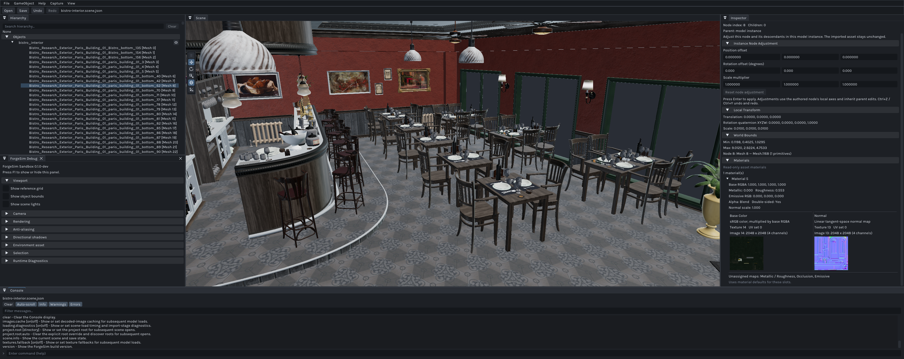
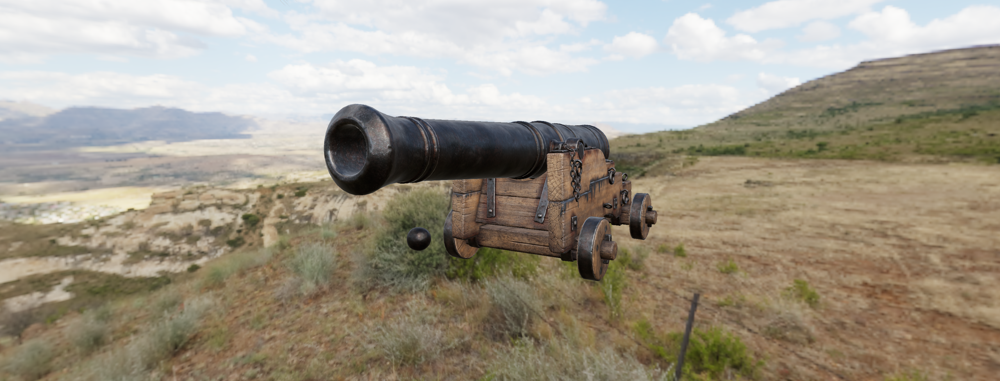
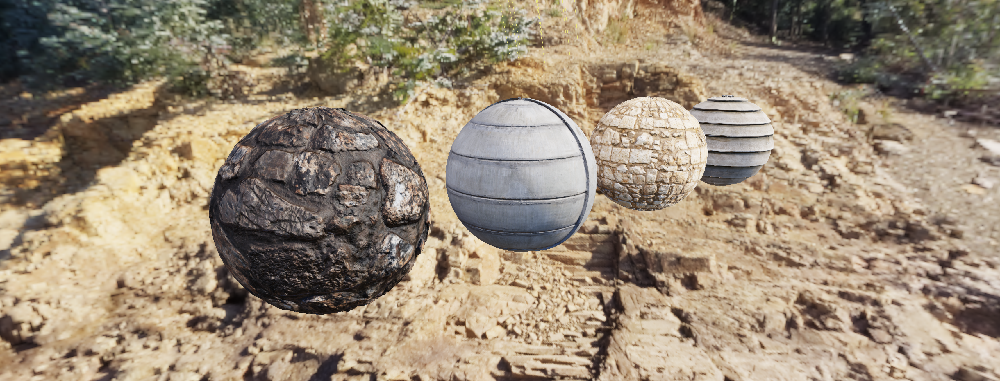

# ForgeSim

ForgeSim is an independently developed real-time simulation engine and editor
written in C++20. Its long-term focus is interactive mechanical systems,
equipment, and training scenarios. The current Sandbox provides the rendering,
asset, scene-editing, and diagnostic tools being built toward that goal.

**Early development:** the current application is a Windows desktop editor using
OpenGL 4.6. Mechanical simulation, maintenance workflows, and immersive interaction
remain future work. Features and file formats continue to evolve.


*The bundled Chess Board sample rendered in ForgeSim under HDR environment lighting.*

[Build from source](#building-from-source-on-windows) ·
[Sample scenes](docs/SampleScenes.md) ·
[Keyboard controls](docs/KeyboardControls.md) ·
[Changelog](CHANGELOG.md) ·
[Roadmap](docs/Roadmap.md)

## What works today

### Scene editing



*An imported Bistro scene with its node hierarchy, per-instance transform controls,
and material inspection. This external scene is not bundled with ForgeSim.*

- Docked Dear ImGui workspace with Hierarchy, Inspector, Scene, and Console panels.
- Model import, scene save/open, object duplication and deletion, and editable lights.
- Viewport selection, transform gizmos, local/world axes, and undo/redo.
- Imported glTF node hierarchies with per-instance node adjustments, subtree
  selection, focusing, and gizmos.
- Fly and orbit camera navigation with per-scene camera settings.
- Material texture inspection with channel views, zoom, panning, and pixel values.
- Per-scene viewport display settings, scene/editor PNG capture, and layout reset.
- Console commands with whole-log copying and individual **Copy line** actions.

See [keyboard controls](docs/KeyboardControls.md),
[imported model hierarchy](docs/ModelHierarchy.md), and
[the runtime Console](docs/runtime-console.md).

### Rendering



*An imported cannon showing textured metal and wood under outdoor HDR lighting.*

The forward renderer supports glTF 2.0 metallic-roughness materials and:

- Base-color, metallic-roughness, normal, occlusion, and emissive textures,
  including supported UV texture transforms.
- Cook-Torrance directional, point, and spot lighting with editable light properties.
- Directional shadow mapping with filtering and bias controls.
- Diffuse irradiance and prefiltered specular image-based lighting.
- HDR equirectangular environments, configurable backgrounds, and vertical HDRI flipping.
- HDR rendering, exposure, ACES approximation or Standard/sRGB display output,
  and explicit linear/sRGB handling.
- Opaque, masked, blended, double-sided, and `KHR_materials_unlit` materials.
- Normal/tangent generation for supported missing source attributes and GLSL hot reloading.

Point and spot lights currently use artistic attenuation and do not cast shadows.
Physical light-unit and exposure calibration remain follow-up work.

See [display transforms](docs/DisplayTransforms.md),
[material texture previews](docs/MaterialTexturePreviews.md), and
[directional shadow validation](docs/DirectionalShadowValidation.md).

### Assets and displacement



*Material spheres used to inspect height displacement, surface relief, and silhouette.
These reference assets are obtained separately.*

- Load `.glb` and `.gltf` models with multiple meshes, primitives, materials, and
  authored node transforms.
- Discover project asset roots through `ForgeSim.project.json`, with explicit
  overrides and missing-asset recovery during editor scene opens.
- Choose HDR environments and height PNGs through native Windows file dialogs.
- Apply per-object/material CPU height displacement using linear 8/16-bit PNG
  sampling, bounded subdivision, independent height UV transforms, and optional
  smooth-seam stitching.
- Save applied height settings with scenes and restore them through undo/redo;
  source models remain unchanged.

Displacement is an opt-in prototype. It requires suitable UVs and geometry;
subdivision does not repair distorted sphere-pole mapping. Blender shader graphs
are not imported. Alternatively, export a GLB with displacement already baked
into its geometry and leave ForgeSim displacement disabled.

See [project asset roots](docs/ProjectAssetRoots.md) and
[height displacement and Blender export](docs/prototypes/HeightDisplacement.md).

### Loading and diagnostics

Unchanged self-contained GLB resources can be reused when reopening scenes in the
same session. Reuse checks source size, modification time, and texture policy;
GLBs with external dependencies and `.gltf` files are reloaded. Source edits that
preserve both size and modification time require a restart to bypass model reuse.

Image loading uses up to four workers, with PNG decompression accelerated by
statically linked libdeflate. An optional decoded-image disk cache avoids
re-decoding eligible embedded GLB images across application restarts. Its default
budget is **4096 MiB**; a smaller limit can be selected at launch.

Use a Release build for timing comparisons:

```bash
./out/build/x64-Release/apps/Sandbox/ForgeSimSandbox.exe --loading-diagnostics --cache-decoded-images
```

Diagnostics report document loading, model preparation, image/cache work,
environment preparation, and scene-open completion. These are host timings;
graphics API submission times do not measure completed GPU execution. Same-session
resource reuse and disk-cache reuse are separate paths.

The cache normally resides at
`%LOCALAPPDATA%/ForgeSim/Cache/decoded-images-v2/` on Windows. It stores uncompressed
decoded pixels and can consume substantial disk space. Older cache versions remain
on disk outside the active version's budget. Disabling caching bypasses the cache
without deleting it; unusable entries fall back to source decoding.

See [scene-loading performance](docs/performance/SceneLoading.md) for measured
results, cache behavior, timing definitions, and repeatable benchmark steps.

## Try the Sandbox

Download an available Windows package from [Releases](https://github.com/L0932/ForgeSim/releases),
or build from source below. For a portable package, extract the complete folder
and keep `assets`, `ForgeSim.project.json`, and dependency notices with the executable.
An OpenGL 4.6-capable graphics driver is required.

Startup and **New Scene** open an empty workspace with a reference grid,
directional light, neutral background, and studio environment lighting.
The grid is an editor aid rather than ground geometry.

Choose **File > Open Sample**:

| Bundled sample | What to explore |
| --- | --- |
| Starter: Directional Shadows | Transform cubes and inspect shadows on a solid floor. |
| Material Gallery | Compare material factors, texture inputs, and roughness. |
| Chess Board | Inspect imported pieces and a table under an interior HDRI. |

Samples include their required assets and open as editable copies. Save asks for
your own destination. Other models shown in development screenshots or discussed
in prototype guides may require separate downloads; they are not automatically
included with the application.

See [sample scenes and asset credits](docs/SampleScenes.md) and
[running the installed application](docs/InstalledApplication.md).

## Use your own assets

Pass a model path to import it at launch:

```bash
./out/build/x64-Release/apps/Sandbox/ForgeSimSandbox.exe "C:/MyProject/models/Example.glb"
```

Open a saved ForgeSim scene with `--scene`:

```bash
./out/build/x64-Release/apps/Sandbox/ForgeSimSandbox.exe --scene "C:/MyProject/scenes/Example.scene.json"
```

Place a `ForgeSim.project.json` manifest in the project folder:

```json
{
  "version": 1,
  "assetRoot": "."
}
```

Keep scenes beneath that folder and store model/environment references relative
to the declared asset root, such as `models/Example.glb`. ForgeSim searches upward
from a scene for the nearest manifest. Standalone model imports without a manifest
use the model's containing folder. No particular drive or asset-directory name is
required. Saving a scene writes references; it does not bundle its assets or create
a manifest.

Use `--project-root "C:/MyProject"` for an explicit root override. In the Console,
`project.root.auto` clears a session override and restores discovery for future
editor opens. See [project asset roots](docs/ProjectAssetRoots.md) for saved sample
copies, fallback behavior, and asset recovery.

Useful launch options:

| Option | Purpose |
| --- | --- |
| `--allow-texture-fallbacks` | Skip unusable texture/UV bindings and retain material factors. |
| `--cache-decoded-images` | Enable the decoded-image disk cache. |
| `--image-cache-budget-mib 1024` | Set a session cache budget; requires caching enabled. |
| `--loading-diagnostics` | Log import progress and loading-stage timings. |
| `--serial-image-decode` | Decode images serially for comparisons. |
| `--help` | Show supported arguments. |

Console commands `images.cache`, `loading.diagnostics`, and `textures.fallback`
accept `on` or `off`, or report the current setting without an argument. They apply
to subsequent loads; changing a setting does not reload the active model.

For large Intel Sponza assets, [Prepare-SponzaTextures.ps1](tools/Prepare-SponzaTextures.ps1)
can create a lower-resolution development copy using ImageMagick. The source
assets must be obtained separately; generated copies should remain outside this
repository.

## Building from source on Windows

Use Git, CMake **3.24 or later**, Ninja, and an x64 MSVC toolchain with C++20 support.
Run commands from a terminal with the x64 MSVC developer environment active.
Check `git --version`, `cmake --version`, `ninja --version`, and `cl` first.

Initial configuration downloads dependencies through CMake FetchContent. GLAD's
generated source is included; generating it does not require Python or Jinja2.

```bash
git clone https://github.com/L0932/ForgeSim.git
cd ForgeSim
```

Configure, build, test, and launch Debug:

```bash
cmake -S . -B out/build/x64-Debug -G Ninja -DCMAKE_BUILD_TYPE=Debug
cmake --build out/build/x64-Debug --parallel
ctest --test-dir out/build/x64-Debug --output-on-failure
./out/build/x64-Debug/apps/Sandbox/ForgeSimSandbox.exe
```

For Release:

```bash
cmake -S . -B out/build/x64-Release -G Ninja -DCMAKE_BUILD_TYPE=Release
cmake --build out/build/x64-Release --parallel
ctest --test-dir out/build/x64-Release --output-on-failure
./out/build/x64-Release/apps/Sandbox/ForgeSimSandbox.exe
```

The test suite covers core timing, asset processing, scene data, selection,
transforms, edit history, displacement, and cache behavior. Native file dialogs
and interactive rendering also require manual Windows checks.

PNG acceleration is enabled by default. Configure with
`-DFORGESIM_ACCELERATE_PNG=OFF` for the stb-only path. Displacement command-line
tools are optional; see the [prototype guide](docs/prototypes/HeightDisplacement.md).
Package preparation and validation are documented in [Releasing](docs/Releasing.md).

## Documentation

| Area | Guides |
| --- | --- |
| Editor | [Keyboard controls](docs/KeyboardControls.md), [camera navigation](docs/CameraNavigation.md), [screenshots](docs/Screenshots.md) |
| Imported models | [Hierarchy and node edits](docs/ModelHierarchy.md), [transforms](docs/ImportedTransforms.md), [texture transforms](docs/TextureTransforms.md) |
| Materials | [Inspection](docs/MaterialInspection.md), [texture previews](docs/MaterialTexturePreviews.md), [display transforms](docs/DisplayTransforms.md), [unlit materials](docs/UnlitMaterials.md) |
| Projects and samples | [Asset roots](docs/ProjectAssetRoots.md), [sample scenes](docs/SampleScenes.md), [installed application](docs/InstalledApplication.md) |
| Diagnostics | [Runtime Console](docs/runtime-console.md), [scene-loading performance](docs/performance/SceneLoading.md) |
| Development | [Architecture](docs/Architecture.md), [roadmap](docs/Roadmap.md), [changelog](CHANGELOG.md), [release process](docs/Releasing.md) |

## Direction and development approach

The longer-term goal is reusable infrastructure for mechanical assemblies,
component interaction and failure, equipment operation, and training scenarios.
Scenario systems and future immersive/VR interaction will build on the current
scene, rendering, and editor foundation.

ForgeSim is developed incrementally around concrete requirements. It includes
fixed-timestep scheduling with bounded catch-up, but this alone does not establish
deterministic simulation. Architecture and acceptance criteria evolve with the
project; see the roadmap for planned work.

AI-assisted tools may be used for research, review, validation, and implementation
assistance. All committed material remains the project owner's responsibility and
must be understood, reviewed, tested, and maintainable. Generated output is subject
to the same verification requirements as other contributions.

## Independent Development

ForgeSim is a personal project developed independently of any employer, client, or contracting engagement.

The project's design, planning, architecture, source code, documentation, and other repository materials are developed using personal resources and maintained separately from work performed for employers or clients.

No confidential information, proprietary material, source code, datasets, work product, or other restricted materials belonging to an employer or client are intended to be incorporated into this repository.

## Repository History

The repository's Git history records the ongoing implementation and evolution of ForgeSim.

Architecture and implementation decisions may change as the project develops. The Git history should be considered the authoritative development record for material committed to the repository.

## Ownership

Unless otherwise explicitly stated, ForgeSim and original material contained in this repository are independently authored personal work.

Third-party libraries and dependencies remain subject to their respective licenses.

### Licensing

ForgeSim is currently under active development.

Copyright © 2026 Arnold Lopez. All rights reserved.

The source code is publicly available for viewing and evaluation. No general license to copy, modify, redistribute, or commercially exploit the original ForgeSim code is granted at this time.

Third-party components remain subject to their respective licenses.

A formal licensing model will be announced in the future.
