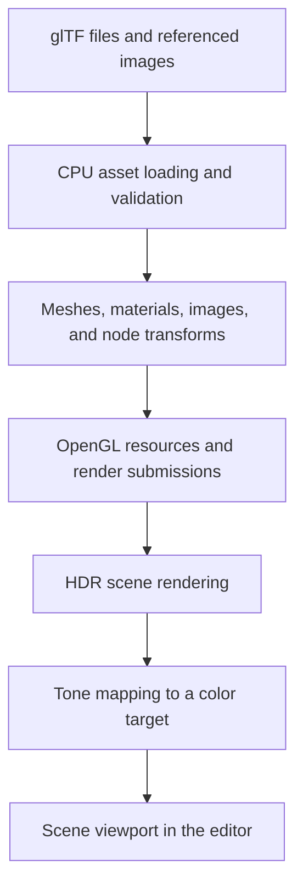

# ForgeSim Architecture

## Purpose and Status

This document describes ForgeSim's implemented architecture, important dependency boundaries, and near-term design considerations.

`Roadmap.md` describes capability goals and delivery order. GitHub issues describe individual changes and acceptance criteria.

ForgeSim uses an incremental approach:

- Implement concrete behavior first.
- Encapsulate responsibilities and dependencies as they become clear.
- Extract reusable behavior when a real consumer or testing boundary justifies it.
- Revisit decisions when implementation provides better evidence.

Future subsystem names and boundaries are provisional. This document does not require creating targets, interfaces, or frameworks ahead of their use.

---

## Current Application Structure

ForgeSim currently runs through the Sandbox executable, which combines scene rendering, development diagnostics, and an evolving editor workspace.

The Sandbox is the composition layer for implemented systems. It also contains scene and authoring behavior that may become reusable engine functionality as requirements develop.

A separate editor executable, general runtime coordinator, and reusable world/component system have not yet been established.

### Main Responsibilities

| Area | Responsibility |
|---|---|
| `main()` | Command-line configuration, application construction, and top-level error handling |
| `SandboxApplication` | Application lifecycle and coordination of input, scene operations, rendering, and editor components |
| Platform | ForgeSim-owned window and input contracts and data |
| PlatformGLFW | GLFW window, OpenGL context, event collection, and native file-dialog implementation |
| Core | Logging, assertions, timing, fixed-step scheduling, and narrow foundational utilities |
| Assets | CPU-side model, image, and material data and asset-loading behavior |
| Renderer | Graphics-facing data, cameras, bounds, picking, and debug geometry |
| RendererOpenGL | OpenGL resources, shaders, textures, render targets, and rendering helpers |
| Sandbox scene and document code | Current object/light representation, serialization, validation, and scene reconstruction |
| Sandbox editor components | Workspace, panels, selection, transform editing, file operations, and editing history |

The CMake targets and their declared dependencies are authoritative. This table summarizes responsibilities rather than prescribing additional targets.

---

## Dependency Principles

### Graphics and Asset Data

CPU-side asset parsing and validation must remain independent of OpenGL.

OpenGL-specific resources and operations belong in the OpenGL renderer implementation or platform context setup. Scene serialization must not store live GPU resources.

Rendering abstractions should express current requirements. A general graphics-backend abstraction is deferred until a concrete second backend requires it.

### UI and Reusable Behavior

Dear ImGui belongs to editor and diagnostic presentation.

Asset loading, validation, scene serialization, transform calculations, and other behavior that does not inherently require UI should remain callable and testable without Dear ImGui.

The Sandbox may compose these systems and adapt their results into UI. A panel should not contain the only implementation of a reusable validation or scene operation.

### Platform Isolation

GLFW and native operating-system details remain behind platform implementation boundaries.

Higher-level interfaces should use ForgeSim-owned data instead of exposing GLFW callback types or native dialog implementation details.

### Explicit Dependencies

Required services and state should be passed through construction, function arguments, or scoped contexts.

Avoid global mutable service locators and shared ownership introduced merely to bypass lifecycle decisions.

---

## Ownership and Lifetime

The executable constructs the application. Application and subsystem owners manage their resources through RAII.

### Window and Graphics Context

`GlfwWindow` owns the native window and OpenGL context.

OpenGL resources must be destroyed before their context is destroyed. When the window and graphics resources are members of the same owner, member declaration order must preserve this destruction order.

Construction must either produce a usable resource or release partially acquired resources before reporting failure.

### Graphics Resources

OpenGL wrapper types manage the lifetime of their underlying GPU objects.

The Sandbox renderer and rendering helpers own the resource instances they use. Resource ownership must remain explicit when resources are replaced, render targets resize, or scene loading fails.

### Scene and Editor State

Scene objects and lights belong to the current scene.

Selection, panels, and editing history refer to scene targets through identifiers or other validated references. Displaying an object does not give a widget ownership of it.

Replacing scene contents must account for selection, pending edits, history, renderer resources, and references held by the application.

---

## Application Loop and Time

`SandboxApplication` coordinates the interactive loop.

The application distinguishes:

- **Real frame time:** monotonic elapsed time measured using `std::chrono::steady_clock`.
- **Fixed update time:** discrete intervals produced by `FixedStepScheduler`.
- **Presentation updates:** frame-driven input handling, camera movement, editor work, and rendering as currently required.

The scheduler bounds catch-up work and reports dropped simulation time. It exposes interpolation alpha for future presentation use.

The scheduler's presence does not imply that physics or a complete simulation runtime already exists.

### Loop Constraints

- Process window events and close requests reliably.
- Handle non-drawable framebuffers without busy looping.
- Pass required timing information explicitly.
- Keep future simulation updates independent of rendering frame rate.
- Keep editor activity from implicitly advancing simulation.
- Preserve valid context lifetime during rendering and shutdown.

Pause, single-step, time scaling, and rendering interpolation will be added when concrete simulation consumers require them.

Detailed frame ordering should be documented alongside the implementation when it affects correctness.

---

## Asset and Rendering Flow

The current asset pipeline loads externally authored glTF content into CPU-side scene, mesh, material, and image data.

OpenGL resources are then created from that data for rendering.

### Asset Responsibilities

The asset layer handles supported source data, useful loading errors, and fallbacks for missing optional information.

Material data describes authored properties and texture references independently of OpenGL object names.

Source files and runtime resources are different representations. Loading a GLB does not establish a general asset database or persistent asset-handle system.

### Rendering Responsibilities

The renderer currently supports the glTF metallic-roughness workflow, direct lighting, image-based lighting, HDR rendering, and tone mapping.

Rendering calculations use linear values. Color textures and display output require appropriate color-space handling; data textures must not receive color-texture conversion.

Scene rendering produces a texture displayed by the editor viewport. Editor UI remains outside scene tone mapping and scene post-processing.

### Rendering Passes

As additional effects are implemented, each pass must define:

- Its inputs and outputs
- Resource ownership
- Execution order
- Resize behavior
- Required graphics state
- State restored or established for subsequent passes

A render graph is not required to make these contracts explicit.

---

## Scene Data and Persistence

The current scene model represents Sandbox objects and lights. It is not yet a general reusable entity/component world.

Scene documents provide a versioned authored representation that can be validated, serialized, loaded, and converted into the current scene.

### Data Categories

| Category | Examples |
|---|---|
| Authored scene data | Object transforms, model references, light properties |
| Transient runtime data | GPU resources, interaction state, temporary rendering data |
| Editor session state | Selection, pending edits, command history |
| Editor preferences | Dock layout, theme, navigation preferences |

These categories may have different storage and lifetime requirements.

A scene document references assets; it does not automatically embed or copy their texture and geometry files.

Current model references follow the project's validated path rules. Stable asset identifiers and relocation support can be introduced when project requirements justify them.

### Persistence Constraints

- Validate documents before applying their contents.
- Report missing files and invalid properties clearly.
- Preserve the current usable scene when a replacement operation fails.
- Reconstruct live resources from authored data.
- Test serialization and conversion independently of the UI.
- Define compatibility behavior when document schemas change.

Camera and rendering-setting persistence should extend the existing document model deliberately. Ordinary navigation should not continuously dirty an authored scene.

---

## Editor Components and Editing

The Sandbox editor is divided into focused components for workspace layout, viewport display, hierarchy, inspection, scene files, selection, and transform editing.

`SandboxApplication` coordinates these components. It should not accumulate widget implementation details or duplicated target-specific editing behavior.

### Transform Editing

Transform editing adapts supported objects and light types into a shared manipulation workflow.

ImGuizmo integration belongs behind the viewport gizmo boundary. Scene editing code handles target conversion, supported operations, application of changes, and history.

An interaction may span multiple frames. History should retain the original state and the final applied state as one logical edit.

### History Scope

Current transform history supports object and light gizmo edits.

This does not imply that all Inspector changes, scene operations, creation, deletion, or hierarchy changes are undoable.

Broader authoring history will be introduced alongside those operations. Reversible editor commands must remain distinct from future gameplay or mechanical-domain operations.

### Viewport Integration

The Scene viewport connects several coordinate spaces:

- Desktop and window coordinates
- ImGui viewport bounds
- Render-target pixel dimensions
- Camera projection and picking coordinates

Rendering, picking, gizmos, and camera navigation must agree on the active viewport bounds and scaling.

Input capture must also respect text entry, active widgets, navigation, and ongoing manipulation.

---

## Errors and Diagnostics

Expected failures should produce useful errors or operation results.

Examples include:

- Missing or invalid assets
- Invalid scene documents
- Unsupported material or model data
- Rejected light properties
- Unavailable platform functionality

Assertions are reserved for programmer invariants. Recoverable failures must remain diagnosable in Release builds.

Diagnostic data belongs near the behavior it describes. ImGui panels and debug rendering present that data.

Performance changes should follow measurements. Loading time should be separated into meaningful stages before introducing caching, asynchronous loading, or threading infrastructure.

---

## Testing Boundaries

Behavior that does not require a graphics context, native window, or tracked hardware should be tested without those dependencies.

Current and evolving test areas include:

- Fixed-step scheduling
- Camera and picking calculations
- Asset parsing and mesh processing
- Material data and fallback behavior
- Transform conversion
- Light validation
- Scene serialization and document conversion
- Editing history
- Scene bounds and camera framing

Rendering correctness, window behavior, docking, and visual quality also require manual verification.

Future physics and VR tests must document hardware requirements and numerical tolerances. Fixed-step scheduling alone does not guarantee cross-platform bitwise determinism.

---

## Near-Term Architectural Focus

### Phase 3: Rendering and Showcases

- Preserve the CPU asset/OpenGL resource boundary.
- Keep rendering effects reusable across showcase scenes.
- Make pass ordering and resource lifetime explicit.
- Measure loading and rendering costs.
- Extend scene documents for reproducible presentation settings.
- Keep asset preparation and showcase art direction separate from renderer behavior.

### Phase 4: Scene Authoring

- Support multiple imported assets without duplicating scene-loading logic.
- Add creation, deletion, hierarchy, and property edits through testable operations.
- Expand undo and redo around meaningful authoring transactions.
- Preserve stable identity and reference validity.
- Keep editor preferences separate from authored scene data.

### Interaction and Early VR

Desktop and VR input should drive the same control state and validated interaction operations.

The first interaction showcase should support buttons, switches, levers, and rotary controls before requiring a complete mechanical assembly system.

Basic VR integration should follow the initial desktop interaction foundation. It should isolate headset rendering, tracked poses, controller actions, session handling, and haptics from scene and domain behavior.

Articulated hands and advanced tool handling can follow later.

Exact world/component, physics, interaction, and XR APIs remain undecided until their implementation provides concrete requirements.

---

## Longer-Term Direction

ForgeSim is intended to support reusable world systems, physics, mechanical assemblies, functional networks, and training scenarios.

The important boundaries are:

- Physics describes motion and constraints.
- Mechanical data records installation, fastening, compatibility, condition, and connectivity.
- Game rules describe progression and rewards.
- Training rules describe procedures and assessment.
- Editor commands provide reversible authoring.
- Runtime interaction invokes domain behavior without depending on editor history.

These principles guide later implementation. They do not require building those subsystems in advance.

---

## Build and Dependency Rules

ForgeSim-owned targets use C++20 and target-scoped CMake configuration.

- Declare sources, includes, features, definitions, and dependencies per target.
- Use public dependencies when required by a target's public interface.
- Keep implementation dependencies private where practical.
- Keep third-party warnings separate from ForgeSim warning policy.
- Link tests only to the dependencies required by the behavior under test.
- Preserve headless testability where the implementation permits it.
- Avoid dependency cycles.
- Introduce new targets when they establish a useful ownership, dependency, testing, or reuse boundary.

Core must remain narrow. It should not become a destination for unrelated utilities merely because multiple systems might eventually use them.

---

## Recording Decisions and Maintaining This Document

Update this document when implemented responsibilities, ownership, or dependency boundaries change.

Ordinary feature work does not require an architecture rewrite.

Use a short architecture decision record when a decision has significant alternatives, lasting consequences, or reasoning that would otherwise be difficult to recover. Small local implementation choices do not require one.

Future proposals should be labeled as provisional. Descriptions of implemented behavior should remain distinguishable from architectural constraints and planned capabilities.

The architecture should explain the code that exists and preserve the reasoning needed to evolve it.